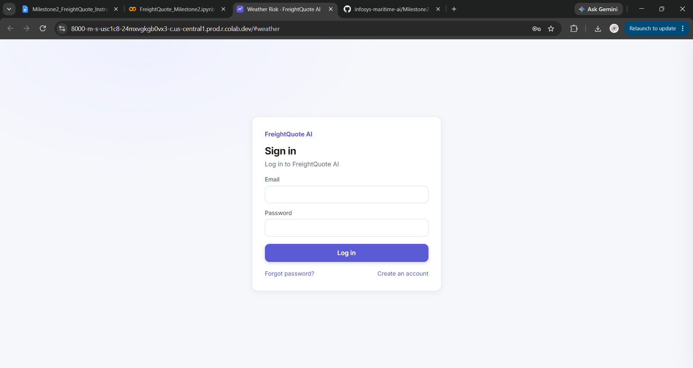
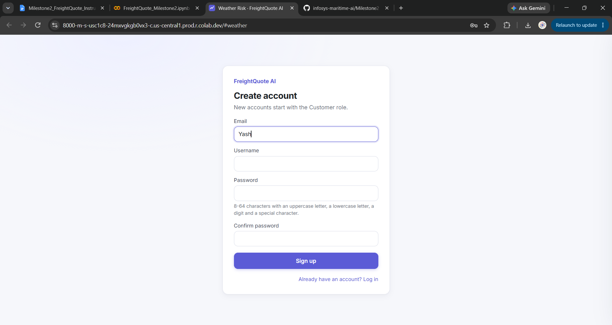
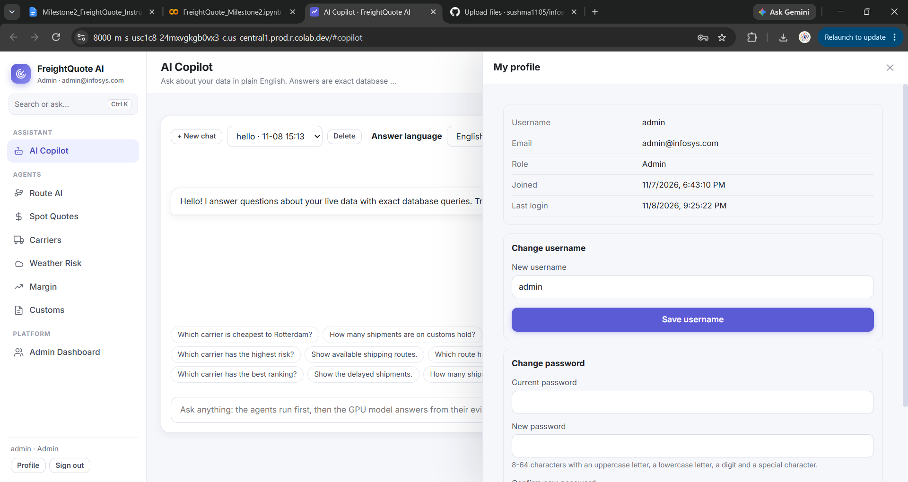
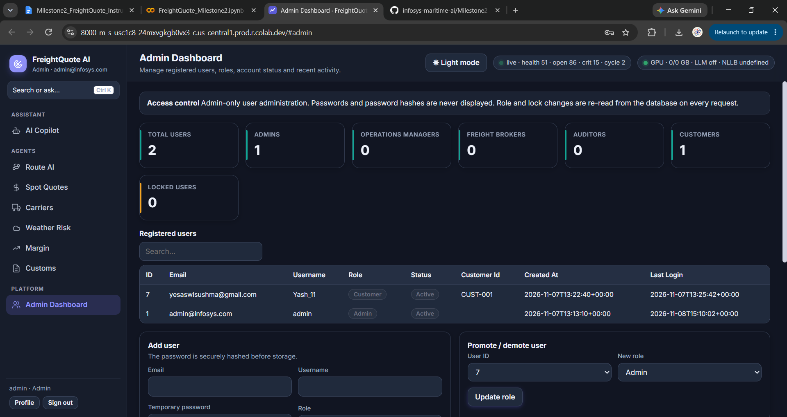
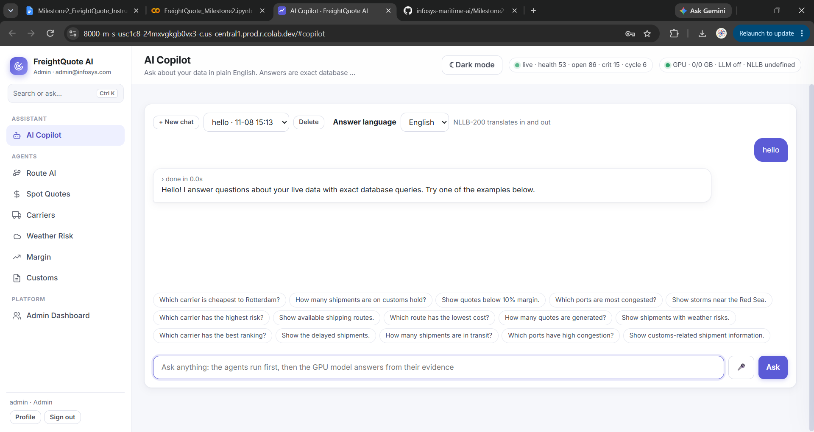
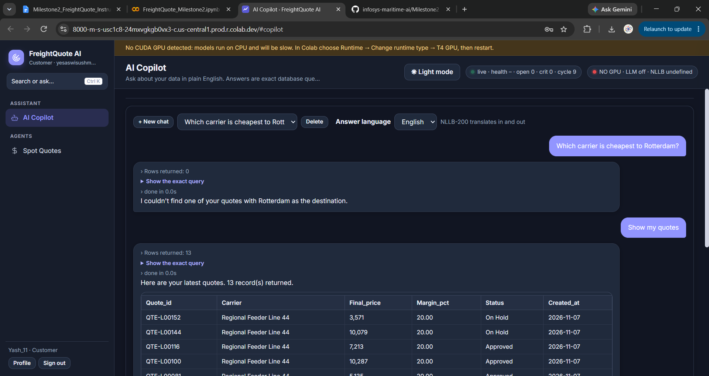
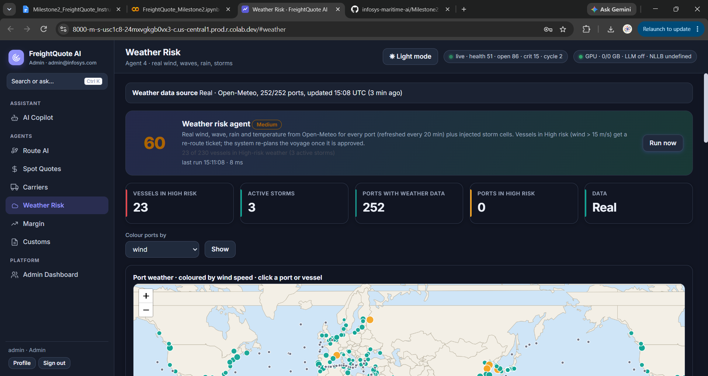

# FreightQuote AI – Milestone 2

**Infosys Springboard Internship 7.0**

## 1. Project Overview

FreightQuote AI is an intelligent freight management application designed to support shipping operations through AI-powered assistance, freight quote generation, carrier information, weather risk monitoring, customs tracking, and margin analysis.

Milestone 2 enhances the existing application with secure authentication, Role-Based Access Control (RBAC), user management, an improved AI Copilot, and a responsive user interface.

## 2. Key Features

### 2.1 Authentication and Profile Management
- User registration and login.
- Secure password hashing.
- JWT-based authentication.
- Forgot-password and password-reset functionality.
- Account locking after repeated incorrect login attempts.
- User profile displaying account information.
- Username and password update options.
- Sign-out functionality.

### 2.2 Role-Based Access Control (RBAC)

The application implements five roles to control access to different pages and operations.

| Feature | Admin | Operations Manager | Freight Broker | Auditor | Customer |
|---|---|---|---|---|---|
| Copilot | Yes | Yes | Yes | Yes | Yes |
| Route AI | Yes | Yes | No | Yes | No |
| Quotes | Yes | No | Yes | Yes | Yes* |
| Carriers | Yes | Yes | Yes | Yes | No |
| Weather | Yes | Yes | No | Yes | No |
| Margin | Yes | No | Yes | Yes | No |
| Customs | Yes | Yes | No | Yes | No |
| Run Agents | Yes | Yes | No | No | No |
| Users | Yes | No | No | No | No |

*Customer access is restricted to their own quotes.*

Additional RBAC capabilities:
- Role-based page navigation.
- Server-side permission enforcement.
- HTTP 403 responses for unauthorized actions.
- Customer-specific quote access.

### 2.3 Admin Dashboard and User Management
- Admin-only dashboard.
- Display registered users and their details.
- Add and delete users.
- Promote and demote user roles.
- Lock and unlock user accounts.
- Activity log for administrative actions.
- KPI cards displaying user statistics.
- Protection against deleting or locking the active Admin account and deleting the last remaining Admin account.

### 2.4 AI Copilot Enhancement and UI Design
- At least 15 new freight-related question patterns.
- SQL-based answers retrieved from application database information.
- Display of SQL queries and returned row counts.
- Handling of spelling mistakes and alternative question wordings.
- RBAC-compliant Copilot responses.
- Helpful responses for unsupported questions.
- Improved interface design and responsive layout.
- Dark mode support.
- Loading states and clear error messages.

## 3. Application Modules

The application includes the following modules:

1. Route AI
2. Spot Quotes
3. Carriers
4. Weather Risk
5. Margin
6. Customs
7. AI Copilot
8. User Profile
9. Admin Dashboard

## 4. Technology Stack

| Category | Technologies |
|---|---|
| Programming Language | Python |
| Backend Framework | FastAPI |
| Frontend | HTML, CSS, JavaScript |
| Database | SQLite |
| Authentication | JSON Web Tokens (JWT) |
| Security | Password Hashing, Role-Based Access Control |
| AI Assistance | SQL-based AI Copilot |

## 5. Project Structure

```text
Milestone2/
│
├── FreightQuote_Milestone2.ipynb
├── README.md
│
└── screenshots/
    ├── 01-login.png
    ├── 02-signup.png
    ├── 03-profile.png
    ├── 04-admin-dashboard.png
    ├── 05-access-denied-403.png
    ├── 06-copilot-database-question.png
    ├── 07-copilot-greeting.png
    ├── 08-generated-quote.png
    └── 09-weather-risk-after-storm.png
```

## 6. Setup and Execution

1. Open `FreightQuote_Milestone2.ipynb` in Google Colab.
2. Configure the required Colab Secrets:
   - `JWT_SECRET`
   - `NGROK_AUTHTOKEN`
   - `EMAIL_ADDRESS`
   - `EMAIL_PASSWORD`
3. Run the notebook cells in the correct order.
4. Open the application using the generated application link.
5. Register or log in using the appropriate user account.
6. Explore the application according to the assigned role and permissions.

### Security Note

Do not upload the following to GitHub:
- Secrets or API tokens.
- `.env` files.
- Passwords or credentials.
- Database files containing user information.

## 7. AI Copilot – Tested Questions

The following are example freight-related questions used to test the AI Copilot:

1. Which carrier is cheapest to Rotterdam?
2. How many shipments are on customs hold?
3. Show quotes below 10% margin.
4. Which ports are most congested?
5. Show storms near the Red Sea.
6. Which carrier has the highest risk?
7. Show available shipping routes.
8. Which route has the lowest cost?
9. How many quotes are generated?
10. Show shipments with weather risks.
11. Which carrier has the best ranking?
12. Show the delayed shipments.
13. How many shipments are in transit?
14. Which ports have high congestion?
15. Show customs-related shipment information.

The Copilot should retrieve answers using actual database queries rather than generating unsupported figures.

**Note:** Actual responses and test results should be documented after verification.

## 8. Screenshots

## 8. Screenshots

The following screenshots demonstrate the key features and functionality of FreightQuote AI – Milestone 2.

### 8.1 Login Page


### 8.2 Signup Page


### 8.3 Profile


### 8.4 Admin Dashboard


### 8.5 AI Copilot – Greeting


### 8.6 Generated Freight Quote


### 8.7 Weather Risk After Storm



## 9. Security and Testing

The application includes the following security and testing requirements:

- Passwords are stored as hashes rather than plain text.
- JWT authentication is used for protected application access.
- Role permissions are enforced on the server.
- Restricted operations are checked for authorization.
- Customer quote access is limited to the respective customer.
- All five roles should be tested using appropriate user accounts.
- Application functionality and role permissions should be verified before final submission.

## 10. Conclusion

Milestone 2 enhances FreightQuote AI with authentication, secure role-based access, administrative user management, an improved SQL-based AI Copilot, and a responsive user interface.

The project demonstrates the integration of backend development, database operations, application security, and AI-assisted freight management in a unified application.

## 11. Team Members and Responsibilities

| Member | Name | Responsibility |
|---|---|---|
| Member 1 | Sama Abhinaya | Authentication and Profile Management |
| Member 2 | Gaikwad Samruddhi Ashok | Role-Based Access Control (RBAC) |
| Member 3 | Vadher Krishnaben Kanjibhai | Admin Dashboard and User Management |
| Member 4 | Yesaswi Sushma | AI Copilot Enhancement and UI Design |

---

**Project:** FreightQuote AI – Milestone 2  
**Program:** Infosys Springboard Internship 7.0  
**Team Size:** 4 Members
